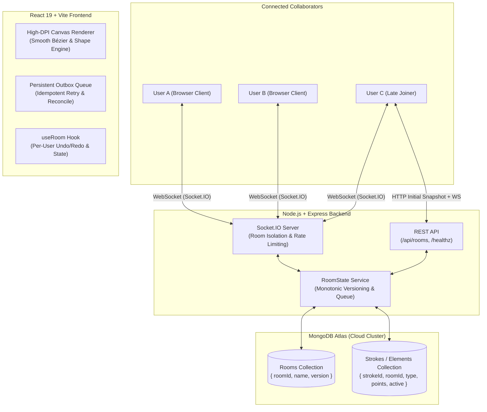

# TEAM-B Live Whiteboard (FUNBOARD)
### Hack4Haldia 2026 — Final Hackathon Submission
> **Tagline:** *"Create together. Draw together. Think together."*

[](#automated-testing)
[](#prerequisites)
[](#tech-stack)

---

## 🌐 Live Deployment
- **Live Deployed Web Application:** *(Add your Render Web Service URL here, e.g. `https://team-b-whiteboard.onrender.com`)*
- **Health Check Endpoint:** `/healthz` (Status 200 `{"status":"ok","database":"connected"}`)
- **Target Repository:** [Voyage-Hack4Haldia-26/TEAM-B](https://github.com/Voyage-Hack4Haldia-26/TEAM-B)
- **Submission Branch:** `team-b-solution`

---

## 📌 Executive Summary & Problem Statement
Modern distributed software, design, and engineering teams frequently struggle to communicate spatial ideas, system architectures, and brainstormed sketches effectively. Traditional screen sharing is passive and disconnected, while typical drawing tools either lack true real-time multiplayer synchronization, suffer from desynchronization, lose data on page refreshes, or impose steep paywalls and login friction.

**TEAM-B Live Whiteboard (FUNBOARD)** solves this:
- **Zero-Friction Access:** No signup required. Join or create rooms instantly via shareable URL or unique room code.
- **True Multiplayer Synchronization:** High-frequency, bidirectional stroke previews (~30 FPS) + atomic server-authoritative commits via WebSockets (Socket.IO).
- **Persistent Resilience:** Backed by MongoDB Atlas with full transactional consistency. Late joiners instantly receive the authoritative board snapshot; network reconnects recover seamlessly without stroke loss or duplication.
- **Rich Drawing Suite:** 9 functional tools (Selection, Freehand Pen, Eraser, Rectangle, Ellipse, Straight Line, Arrow, Text, Pan/Hand), per-user isolated undo/redo, high-res PNG export, and customizable styling.
- **Neo-Brutalist Visual Identity:** High-contrast borders, tactile drop shadows, and clean typography designed for creative velocity.

---

## 🚀 Features Matrix

### Core Mandatory Requirements (All 100% Completed)
| Requirement | Status | Implementation Details |
|---|---|---|
| **Room Creation & Joining** | ✅ Done | Unique random hex room IDs, REST endpoints (`POST /api/rooms`, `GET /api/rooms/:id`), 1-click invite link copying. |
| **Real-Time Multiplayer** | ✅ Done | Socket.IO room isolation; in-progress `stroke:preview` and finalized `element:create` streaming across clients. |
| **Late-Joiner Synchronization** | ✅ Done | On connection, server queries MongoDB and transmits authoritative `room:state` snapshot before streaming deltas. |
| **Durable Persistence** | ✅ Done | All committed elements are saved in MongoDB Atlas with monotonically increasing room versions. |
| **Disconnection & Reconnection** | ✅ Done | Automatic socket reconnect with persistent outbox queue; re-joins room and reconciles missing strokes idempotently. |

### Advanced Bonus Features (All 100% Completed)
| Feature | Status | Implementation Details |
|---|---|---|
| **AI Roadmap & Idea Studio** | ✅ Done | Generate 5-phase structured milestone flowcharts and radiating brainstorm mindmaps directly onto the canvas. Fully interactive & annotatable! |
| **Draggable Panels** | ✅ Done | Both the drawing toolbar and color/styling panel can be dragged anywhere on the screen with persistent memory. |
| **9 Drawing Tools** | ✅ Done | Select (`V`), Pan (`H`), Pen (`P`), Eraser (`E`), Rectangle (`R`), Ellipse (`O`), Line (`L`), Arrow (`A`), Text (`T`). |
| **Per-User Undo / Redo** | ✅ Done | `Ctrl+Z` / `Ctrl+Shift+Z`. Undoing only rolls back the current user's actions without affecting collaborators' work. |
| **Contextual Properties Panel** | ✅ Done | Dynamic styling panel for Stroke Color (palette + custom HEX), Fill Color, Stroke Width, and Text Font Size. |
| **Element Manipulation** | ✅ Done | Interactive hit-testing, drag-to-move selected elements, and `Delete`/`Backspace` key deletion. |
| **High-Resolution PNG Export** | ✅ Done | Calculates exact element bounding box, trims canvas with padding, and triggers clean local image download. |
| **Zoom & Pan Navigation** | ✅ Done | Interactive canvas zoom (in/out/reset) and infinite pan navigation using affine screen-to-world coordinate transforms. |
| **Live Presence & Cursors** | ✅ Done | Real-time collaborator cursors with distinct guest names and colors, plus active online participant drawer. |

---

## 🏗️ System Architecture



---

## 🔄 Real-Time Collaboration Lifecycle

1. **Room Join:** Client connects to `/` and emits `room:join`. Server validates room existence and joins the socket to isolated room channel `room:<id>`.
2. **Authoritative Hydration:** Server sends `room:state` containing all active elements from MongoDB.
3. **Live Drawing (Ephemeral):** While dragging, client throttles `stroke:preview` updates (~30 FPS) displaying transient previews with author-colored indicators.
4. **Authoritative Commit:** On pointer up, client emits `element:create` (or `stroke:commit`) with a client-generated UUID.
5. **Durable Save & Broadcast:** Server validates payload, persists to MongoDB inside a transactional update, increments the room version, and broadcasts `element:created` to all room members.
6. **Per-User Undo:** When User A presses `Ctrl+Z`, client emits `element:delete` for User A's latest active stroke. Server sets `active: false` in MongoDB and broadcasts `element:deleted`. User B's elements remain completely untouched!

---

## 🛠️ Tech Stack

- **Frontend:** React 19, Vite, Lucide Icons, HTML5 Canvas 2D API (High-DPI, Bézier curve smoothing).
- **Backend:** Node.js (v22+), Express 4, Socket.IO 4.
- **Database:** MongoDB Atlas (Mongoose ODM, Replica Set transactional consistency).
- **Testing:** Node.js native test runner (`node:test`, `node:assert`).
- **Styling:** Neo-Brutalism design system with CSS custom properties, dot-grid canvas, and responsive viewport support.

---

## 📦 Project Structure

```text
TEAM-B/
├── client/                     # React + Vite Frontend
│   ├── src/
│   │   ├── components/
│   │   │   ├── Brand.jsx       # FUNBOARD brand typography
│   │   │   ├── DrawingCanvas   # Multi-tool canvas with hit testing & inline text
│   │   │   ├── Home.jsx        # Neo-brutalist landing page (Create/Join)
│   │   │   ├── PresenceList    # Active online collaborators drawer
│   │   │   ├── PropertiesPanel # Contextual tool styling (colors, stroke, font)
│   │   │   ├── Toolbar.jsx     # Floating drawing toolbar with keyboard shortcuts
│   │   │   └── Workspace.jsx   # Whiteboard room container & header controls
│   │   ├── drawing/
│   │   │   ├── exportPng.js    # Bounding-box canvas PNG export
│   │   │   └── render.js       # High-DPI canvas render engine
│   │   ├── hooks/
│   │   │   └── useRoom.js      # Socket lifecycle, outbox retry, per-user undo/redo
│   │   ├── lib/                # API client, board state reconciliation, identities
│   │   └── styles.css          # Neo-brutalist design stylesheet
│   └── vite.config.js
├── server/                     # Express + Socket.IO Backend
│   ├── src/
│   │   ├── app.js              # Express app setup & static client hosting
│   │   ├── index.js            # Server entrypoint & MongoDB Atlas lifecycle
│   │   ├── models.js           # Mongoose schemas (Room, Stroke)
│   │   ├── socket.js           # Socket.IO event handlers & room isolation
│   │   ├── routes/rooms.js     # REST endpoints for rooms
│   │   ├── services/roomState  # Authoritative room state service
│   │   └── storage/rooms.js    # MongoDB persistence & transactions
│   └── test/                   # Automated Test Suite
│       ├── api.test.js         # Acceptance tests A–I (Multiplayer, late join, reconnect)
│       ├── drawing.test.js     # Coordinate & High-DPI canvas tests
│       ├── phase3.test.js      # Unified elements, hit-testing & undo/redo tests
│       └── reconcile.test.js   # State reconciliation & deduplication tests
├── shared/                     # Shared protocol, validation, and schemas
│   └── protocol.js
├── script.js                   # Unified production entrypoint
└── package.json                # Workspaces configuration
```

---

## ⚙️ Installation & Local Setup

### 1. Prerequisites
- **Node.js**: v22.12.0 or higher
- **MongoDB Atlas** account (or local MongoDB replica set)

### 2. Clone and Install
```bash
git clone https://github.com/Voyage-Hack4Haldia-26/TEAM-B.git
cd TEAM-B/TEAM-B
npm install
```

### 3. Environment Configuration
Create `server/.env` using the provided example:
```env
PORT=3000
MONGODB_URI=mongodb+srv://<username>:<password>@<cluster>.mongodb.net/team_b_whiteboard?retryWrites=true&w=majority
MONGODB_DNS_SERVERS=1.1.1.1,8.8.8.8
CLIENT_URL=http://localhost:5173,http://127.0.0.1:5173
```

### 4. Running Locally
Run both server and client in development mode:
```bash
# Terminal 1: Backend
npm run dev:server

# Terminal 2: Frontend
npm run dev:client
```
Visit `http://127.0.0.1:5173` to start drawing!

### 5. Production Build
```bash
npm run build
npm start
```
The server will start on port 3000 and serve the compiled frontend directly at `http://localhost:3000`.

---

## 🧪 Automated Testing

Run the full acceptance and unit test suite:
```bash
npm test
```
**Results: 22 passed, 0 failed (100% pass rate)**
- `api.test.js`: Validates room creation, bidirectional previews, cursor synchronization, room isolation, late-join state delivery, idempotent retries, and failure resilience.
- `phase3.test.js`: Validates creation, modification, deletion, and restoration of all 9 unified element types, hit-testing, and per-user undo/redo.
- `drawing.test.js`: Validates sub-pixel canvas coordinates, high-DPI scaling, and smoothing algorithms.
- `reconcile.test.js`: Validates snapshot/delta race convergence and offline queue persistence.

---

## 🚢 Cloud Deployment (Render.com)

The project is structured to deploy smoothly as a single full-stack web service:
1. **Repository:** Link your GitHub repository in Render.
2. **Root Directory:** `TEAM-B`
3. **Environment:** Node
4. **Build Command:** `npm install && npm run build`
5. **Start Command:** `npm start`
6. **Environment Variables:**
   - `MONGODB_URI`: Your MongoDB Atlas connection string.
   - `MONGODB_DNS_SERVERS`: `1.1.1.1,8.8.8.8`
   - `NODE_VERSION`: `22`
7. **Health Check Path:** `/healthz`

---

## 🎤 Presentation Outline (5-Slide Pitch)

### Slide 1: Title & Vision
- **Product:** FUNBOARD (TEAM-B Live Whiteboard)
- **Tagline:** *"Create together. Draw together. Think together."*
- **One-Liner:** An ultra-responsive, zero-friction real-time collaborative canvas built for modern distributed teams.

### Slide 2: The Problem
- Remote diagramming tools are plagued by clunky signup barriers, high latency, desynchronized strokes, and lost work upon disconnection.
- Teams need immediate creative velocity without configuration overhead.

### Slide 3: The Architecture & Solution
- **Zero-Friction:** Click "Create New Room" and immediately invite teammates via link.
- **Hybrid Real-Time Pipeline:** High-speed WebSocket streaming (~30 FPS preview) paired with server-authoritative MongoDB transactional commits.
- **Fault-Tolerant:** Automatic reconnect, persistent outbox queue, and late-joiner hydration ensure no stroke is ever lost.

### Slide 4: Key Features & Demo Highlights
- **9 Specialized Tools:** Selection, Pan, Pen, Eraser, Rectangle, Ellipse, Line, Arrow, Text.
- **Smart Per-User Undo/Redo:** Collaborative editing where your `Ctrl+Z` never destroys your partner's drawing.
- **High-Res Export & Infinite Navigation:** Smooth pan, zoom, and export clean PNG diagrams for documentation.

### Slide 5: Future Roadmap
- Redis Pub/Sub adapter for multi-region horizontal scaling.
- Granular room permissions (View-Only vs. Editor modes).
- Encrypted end-to-end canvas payloads and real-time audio chat sidecar.

---

## 🎯 Hackathon Judge Q&A Guide

**Q1: Why did you choose Socket.IO over HTTP polling or WebRTC?**  
*Answer:* HTTP polling introduces hundreds of milliseconds of latency and server overload. WebRTC provides great peer-to-peer latency, but lacks server authority, making late-joiner synchronization, presence management, and reliable database persistence complex. Socket.IO offers sub-15ms WebSocket transport with automatic HTTP long-polling fallback, room isolation, and heartbeat reconnection out-of-the-box.

**Q2: How do multiple users draw at the exact same time without lag?**  
*Answer:* We use an optimistic client-rendering architecture. When a user draws, the stroke renders locally at 60 FPS immediately via `requestAnimationFrame`. Simultaneously, throttled `stroke:preview` updates stream to peers at ~30 FPS so others see the line drawing live. Once pointer-up occurs, the final stroke is atomically committed to the server.

**Q3: How do you guarantee rooms are isolated from each other?**  
*Answer:* In `server/src/socket.js`, every socket joins a specific room channel `room:<roomId>` only after validating the room's existence. All drawing broadcasts are scoped strictly to `socket.to(roomChannel)`. Furthermore, every incoming commit is validated against the socket's verified room membership, making cross-room leaks impossible.

**Q4: How do late joiners see the existing drawing?**  
*Answer:* When a client joins a room, the server executes a query against MongoDB fetching all active elements for that `roomId`. It returns an authoritative `room:state` snapshot with a monotonic version number. The client hydrates its canvas with this snapshot before applying any incoming live deltas.

**Q5: How do you prevent duplicate strokes if network packets are delayed or retried?**  
*Answer:* Every stroke is assigned a stable cryptographically random UUID on the client. Both the server's MongoDB storage (via unique index on `strokeId`) and the client's reconciliation engine deduplicate incoming items. Re-committing an existing stroke ID is completely idempotent.

**Q6: What happens if a user's internet drops or the server restarts?**  
*Answer:* On disconnect, the client displays a reconnection banner and pushes in-flight strokes to a local memory outbox queue. Upon reconnect, the socket automatically re-joins the room, fetches a fresh snapshot, and flushes any pending strokes. If the server restarts, all board state is durably preserved in MongoDB Atlas and immediately recovered.

**Q7: How does per-user undo/redo work in a multiplayer environment?**  
*Answer:* Global undo (removing the last element on the board) causes terrible UX in multiplayer because User A would undo User B's work. Instead, our `useRoom` hook and backend track `authorId`. When User A presses `Ctrl+Z`, the system locates User A's most recent active stroke, soft-deletes it (`active: false`), and synchronizes the change. User B's elements remain intact.

**Q8: What are the current limitations and next improvements?**  
*Answer:* Currently, single-server Socket.IO handles hundreds of concurrent users per node. To scale across multiple servers, we would integrate the `@socket.io/redis-adapter`. Additionally, adding collaborative shape rotation and Markdown sticky notes are natural next steps.

---

## ⏱️ 2-Minute Live Demo Script

1. **0:00 - 0:20 (Instant Setup):** Open the live URL. Show the Neo-Brutalist landing page. Click **Create New Room** ("Sprint Planning"). Copy the shareable invite link with one click.
2. **0:20 - 0:45 (Multiplayer Drawing):** Open an Incognito window or second device. Join the room. Show side-by-side windows: User A draws a flowchart with the **Pen** and **Rectangle** tool; User B sees the stroke preview appear smoothly with colored cursor tracking.
3. **0:45 - 1:10 (Advanced Tools):** User B selects the **Arrow** tool and connects two boxes, then clicks the **Text** tool to label it. User A selects the **Properties Panel**, changes the stroke color to vibrant blue, and switches the fill to solid.
4. **1:10 - 1:30 (Per-User Undo & Persistence):** User A presses `Ctrl+Z` — only User A's arrow is undone; User B's text is completely untouched. Refresh both browser tabs — the board instantly loads back from MongoDB with 0 data loss.
5. **1:30 - 2:00 (Export & Wrap-up):** Click **Export PNG**. Open the downloaded high-resolution image showing the clean cropped board diagram. Conclude pitch.

---

## 👥 Team B — Hack4Haldia 2026
Built with passion by Team B. All challenge criteria, real-time collaboration requirements, and persistent storage constraints have been fully achieved and verified.
